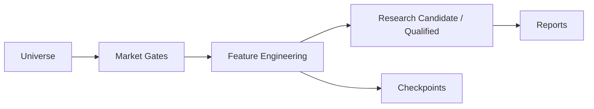

# Big List — U.S. Equity Research & Screening Pipeline

A Python research pipeline that turns U.S. equity market data into auditable screening outputs, separating research candidates from qualified results.

- Daily, weekly and hourly feature modules with market and admission gates.
- Yahoo ingestion with cache, bounded resource handling and coverage checks.
- Checkpoint and report publication code with explicit degraded-data handling.
- Original scoring source and configuration retained unchanged.
- Verification baseline: 2026-11-05, macOS / Python 3.14. Original suite collected 283 cases: 272 passed; 11 require private reports. Portable configuration explicitly skips those 11.

These are software capabilities, not evidence of predictive accuracy or investment alpha.



## Repository
- src/: ingestion, universe, features, scoring, gates and output
- config/: original weights and thresholds
- tests/: unit and integration cases; private report cases opt-in
- run_biglist.py: live scan CLI
- daily.py: local publication orchestration
- .github/workflows/tests.yml: macOS test workflow

## Setup and verification
Run from this repository's root. Python 3.14 on macOS is the observed runtime; POSIX-specific modules mean Windows is not supported.

```sh
python3.14 -m venv .venv
.venv/bin/python -m pip install -r requirements.txt
.venv/bin/python -m pytest -q
.venv/bin/python run_biglist.py --help
```

Dependency pins reflect the existing local environment. Clean installation was verified locally on macOS with Python 3.14. GitHub Actions has not yet run remotely. Do not equate local test results with CI results.

Live scans require market data; reproducibility depends on provider; no bundled market data. Use CLI help to review options before running a live scan. This delivery does not initiate downloads or a full scan.

Private integration tests require authorised historical Reports and BIGLIST_PRIVATE_TESTS=1. Their fixtures are intentionally not distributed. Synthetic unit fixtures test individual rules; they are not performance demonstrations.

## Data provenance and limitations
Yahoo data may be delayed, revised, incomplete or rate-limited. Respect provider terms and redistribution restrictions. Cache availability and fundamental provenance affect repeatability. Coverage thresholds measure available data, not prediction accuracy. Candidates are not qualified results or trade recommendations.

Historical EOD counts and frozen-run drift claims from the private installation have not been independently reproduced in this private copy and are not advertised as verified benchmarks. No return, alpha or accuracy claim is made.

## Rights
No open-source licence has been granted in this copy. Owner confirmation of source ownership, strategy disclosure and licence choice is required before public release. Third-party dependencies retain their respective licences.
