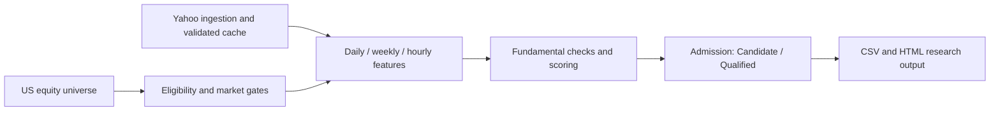

# Big List — U.S. Equity Research & Screening Pipeline

[MIT License](LICENSE) · [Offline tests](https://github.com/Allen-so/biglist-equity-research/actions/workflows/tests.yml)

Open-source Python pipeline for systematic U.S. equity screening, multi-timeframe signal engineering and auditable research output.

A financial data analytics and engineering portfolio project that turns a U.S. equity universe into structured research evidence. It separates **Candidate** from **Qualified** results through explicit data-quality, market and admission gates. This is a research tool, not trade recommendations.

## What it does

- Loads a U.S. equity directory and applies static eligibility and market gates.
- Engineers daily, weekly and hourly features, including relative strength, volume flow, structure and confluence.
- Incorporates fundamental checks and configurable scoring weights and thresholds.
- Exports research results and coverage audits; reporting modules support CSV and HTML output.



## Engineering highlights

- Bounded ingestion, HTTP 429 cooldowns, timeouts and file-descriptor exhaustion handling.
- Cached data with validation receipts and persistent checkpoints to support recovery.
- Completed-session checks using New York market time; coverage gates expose missing data.
- Atomic file replacement and guarded publication of the latest daily report.
- Offline tests for feature rules, gates, ingestion resource handling and publication behavior.

**Stack:** Python, pandas, NumPy, PyArrow, requests, curl_cffi, yfinance, PyYAML and pytest. Dependencies are pinned in `requirements.txt`.

## Getting started

Python **3.14 on macOS** is the verified target. POSIX-specific modules mean Windows is not supported. A public repository can be downloaded through **Code → Download ZIP**, without an account, or cloned:

```sh
git clone https://github.com/Allen-so/biglist-equity-research.git
cd biglist-equity-research
python3.14 -m venv .venv
source .venv/bin/activate
python -m pip install -r requirements.txt
python -m pytest -q
python run_biglist.py --help
```

### Execution modes

The following commands access external market-data services; availability and provider terms apply:

```sh
# Limited-universe smoke scan; ranks and breadth are not full-universe results
python run_biglist.py --max-symbols 20 --workers 2

# Full eligible universe
python run_biglist.py

# Refresh provider data rather than relying on ordinary cache reuse
python run_biglist.py --refresh
```

Use `--batch-size`, `--workers` (1–8), `--cache-dir` and `--output-dir` to control execution. Defaults are `data/cache` and `outputs`; limited scans write under `outputs/smoke`. A live scan can stop when coverage or benchmark freshness checks fail. No live scan is required to run the offline tests.

## Verification and reproducibility

The recorded local baseline is **272 passed, 11 skipped** on macOS / Python 3.14. The 11 skipped cases require private historical reports, which are not distributed. Enable `BIGLIST_PRIVATE_TESTS=1` only when those authorized fixtures are available. The linked GitHub Actions page is the authoritative remote CI status.

This clean source distribution contains no bundled market-price dataset. Its hourly JSON fixture is explicitly synthetic and tests parsing behavior. Private production scans are not reproducible benchmarks for this checkout, and no trading accuracy, returns or alpha are claimed.

Yahoo data may be delayed, revised, incomplete or rate-limited. Data coverage measures availability, not predictive accuracy. Provider terms govern data access and redistribution independently of the software license. Full live execution has external-data requirements beyond offline installation and tests.

## Project structure

- `src/universe/`, `src/data/`: universe selection, ingestion, coverage and checkpoints.
- `src/features/`, `src/regime/`: signal engineering and market context.
- `src/core/`, `src/gates/`, `src/scoring/`: pipeline, admission and scoring.
- `src/output/`: research report formatting.
- `config/`: scoring weights and thresholds.
- `tests/`: offline tests and opt-in private-report integration cases.
- `run_biglist.py`: live scan CLI; `daily.py`: daily publication orchestration.

## License and contributions

Project source and documentation are available under the [MIT License](LICENSE): anyone may use, modify and redistribute them, including commercially, while preserving the license notice. Third-party dependencies retain their own licenses; MIT does not license provider data.

Issues and pull requests are welcome. Include a reproducible example and relevant offline tests; do not commit credentials, provider dumps, private reports or caches. Changes to financial rules should explain their assumptions and remain distinct from performance claims.

For research and education only. Not investment advice; software is provided without warranty.
